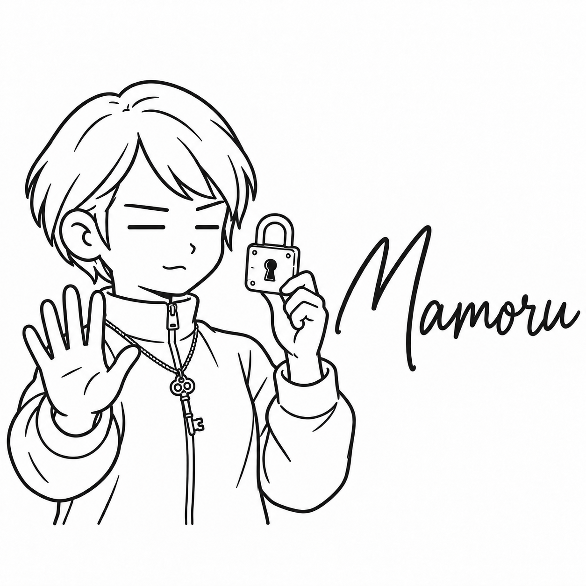

# まもる

| 項目 | 内容 |
| --- | --- |
| ポジション | セキュリティエンジニア |
| 興味のあること | 城の守りの仕組み |
| 得意なこと | 建物に入ると、まず入り口と出口を数える |
| 苦手なこと | 「とりあえず全部許可」 |
| 好きな食べ物 | 小籠包（皮で中身を守る） |
| 口癖 | 「入り口はいくつある？」 |
| 学生の時に学んだこと | 歴史学。城と守りの仕組み |
| 最近気になっていること | 石垣の積み方 |
| 休日の過ごし方 | 城をめぐって石垣を見る |
| 見た目の特徴 | あごまでのまっすぐな短い髪、ファスナーを上まで上げたハイネックのジャケット、首にさげた古い鍵、双眼鏡 |
| 仲のよいキャラクター | しるべ（城の縄張りと古い地図の話が合う） |
