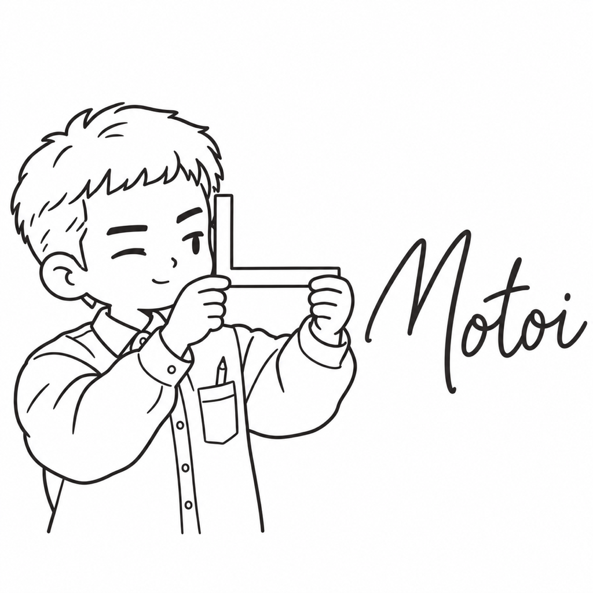

# もとい

| 項目 | 内容 |
| --- | --- |
| ポジション | プラットフォームエンジニア |
| 興味のあること | 自転車の部品 |
| 得意なこと | ブレーキとギアの調整 |
| 苦手なこと | 油の切れたチェーン |
| 好きな食べ物 | 毎日同じ完全栄養食 |
| 口癖 | 「先に整備しておこう」 |
| 学生の時に学んだこと | 機械工学。部品の仕組みと整備 |
| 最近気になっていること | 3Dプリンターで部品を作ること |
| 休日の過ごし方 | 自転車を手入れして、少し遠くまで走る |
| 見た目の特徴 | 短い髪、胸ポケットの付いた作業用シャツ、胸ポケットの鉛筆、曲尺 |
| 仲のよいキャラクター | たもつ（自転車と盆栽を、毎日手入れする仲） |
