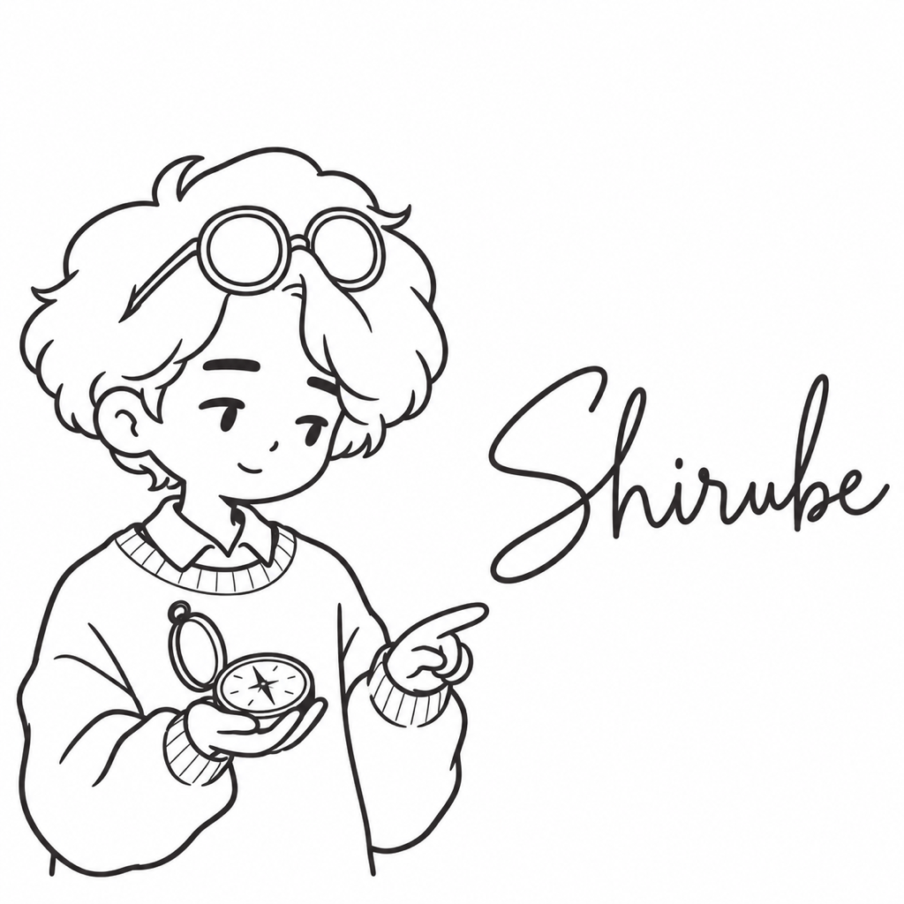

# しるべ

| 項目 | 内容 |
| --- | --- |
| ポジション | テックリード |
| 興味のあること | 古い地図と測量 |
| 得意なこと | 初めての町でも、方角を外さずに目的地に着く |
| 苦手なこと | 行き先を決めずに歩き出すこと |
| 好きな食べ物 | 山の上で食べるおにぎり |
| 口癖 | 「まず現在地を確かめよう」 |
| 学生の時に学んだこと | 地理学。地図の作り方と測量 |
| 最近気になっていること | 古い街道の跡 |
| 休日の過ごし方 | 古い地図を片手に、旧道を歩く |
| 見た目の特徴 | もこもこした雲のような髪、額に押し上げた丸眼鏡、丸首のセーター、方位磁針 |
| 仲のよいキャラクター | わたる（古い地図と案内表示で、道の話が合う） |
