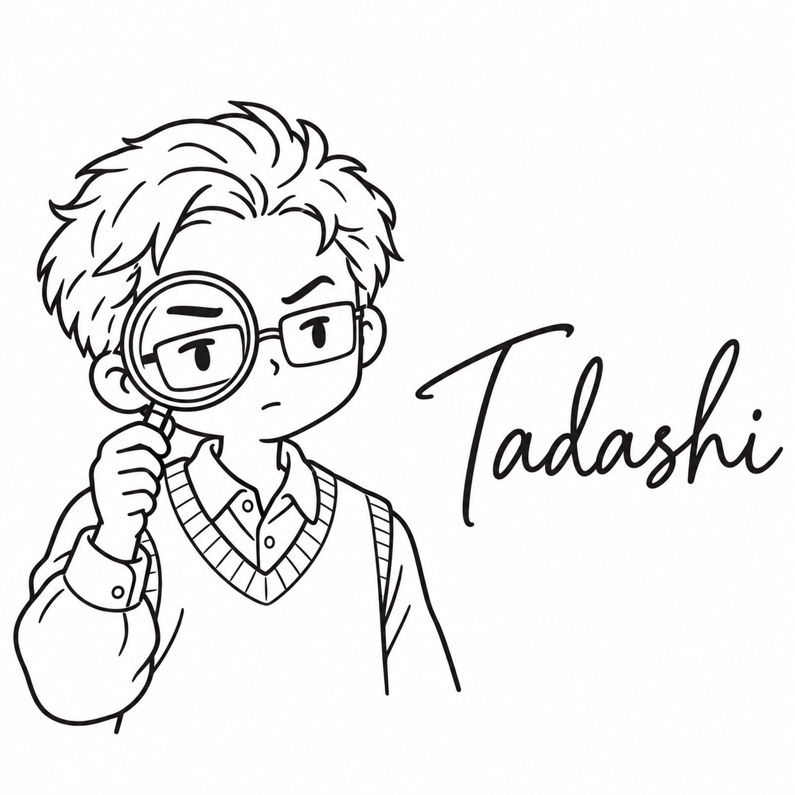

# ただし

| 項目 | 内容 |
| --- | --- |
| ポジション | QAエンジニア |
| 興味のあること | 理科の実験 |
| 得意なこと | 自動販売機で、お金を入れる順番を変えて試す |
| 苦手なこと | 1回しか試せないこと |
| 好きな食べ物 | ゆで卵（ゆで時間を毎回はかる） |
| 口癖 | 「もう一回、条件を変えてみよう」 |
| 学生の時に学んだこと | 化学。条件を変えて試す実験 |
| 最近気になっていること | 古い電卓の仕組み |
| 休日の過ごし方 | 料理の分量を変えて、何度も作り比べる |
| 見た目の特徴 | 毛先のはねた短い髪、四角い眼鏡、襟付きのシャツにニットのベスト、2本の試験管 |
| 仲のよいキャラクター | もとい（条件を変えて試すのと、整備して確かめるので、手を動かす仲） |
