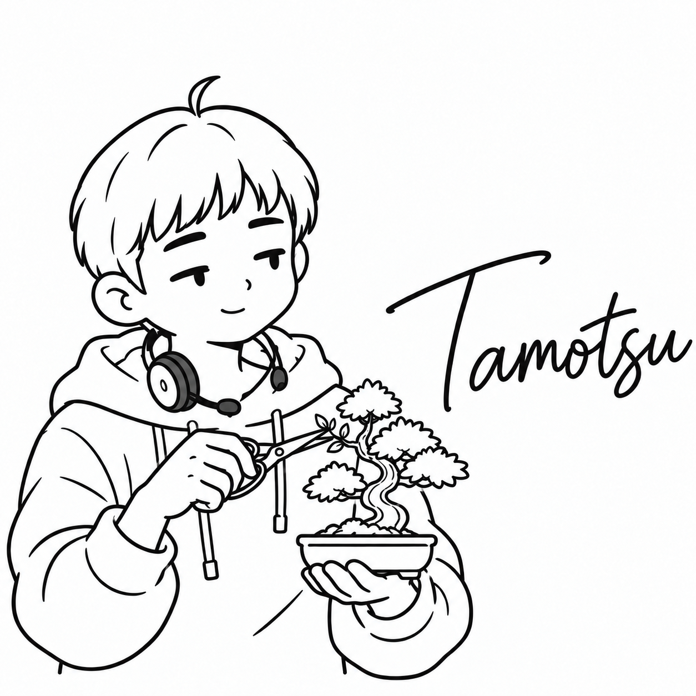

# たもつ

| 項目 | 内容 |
| --- | --- |
| ポジション | SRE |
| 興味のあること | 盆栽 |
| 得意なこと | 観葉植物を枯らさない |
| 苦手なこと | 水やりを頼めない長い旅行 |
| 好きな食べ物 | ぬか漬け |
| 口癖 | 「毎日少しずつ見ておくね」 |
| 学生の時に学んだこと | 園芸学。植物の育て方 |
| 最近気になっていること | 盆栽の新しい品種 |
| 休日の過ごし方 | 朝早く起きて盆栽を手入れする |
| 見た目の特徴 | てっぺんに寝ぐせが1本はねた短い髪、パーカー、首にかけた片耳のヘッドセット、盆栽とはさみ |
| 仲のよいキャラクター | もとい（自転車と盆栽を、毎日手入れする仲） |
