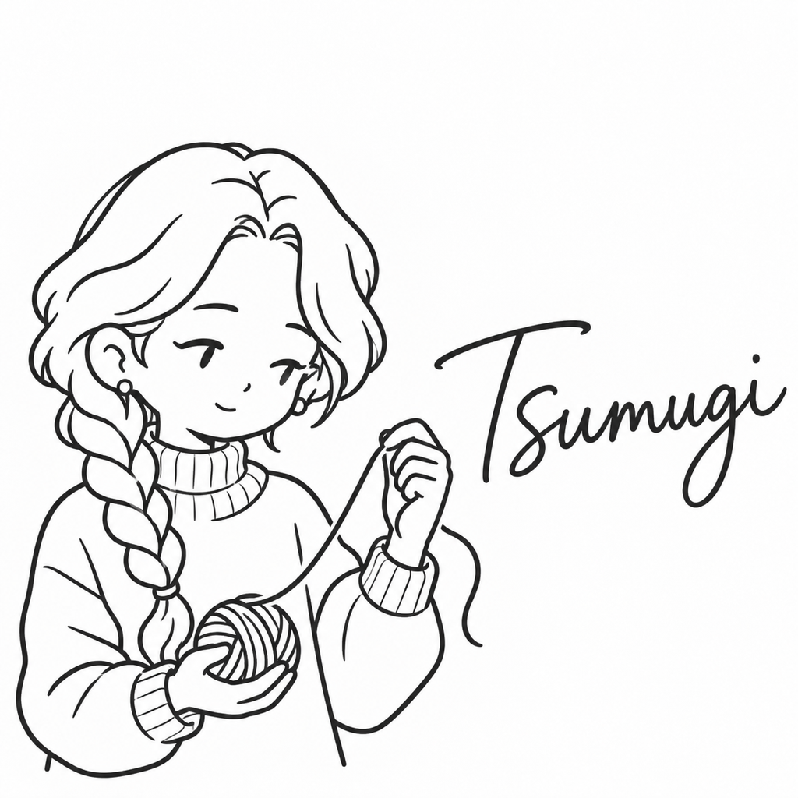

# つむぎ

| 項目 | 内容 |
| --- | --- |
| ポジション | バックエンドエンジニア |
| 興味のあること | 機織りと糸 |
| 得意なこと | 絡まった糸を、根気よくほどく |
| 苦手なこと | 結び目の分からない荷物 |
| 好きな食べ物 | 手打ちのうどん |
| 口癖 | 「糸の端はどこ？」 |
| 学生の時に学んだこと | 服飾。織物と糸の性質 |
| 最近気になっていること | 草木染め |
| 休日の過ごし方 | 機織りの教室に通う |
| 見た目の特徴 | 右の肩の前に垂らした太い三つ編み1本、タートルネックのニット、小さな丸いピアス、毛糸玉 |
| 仲のよいキャラクター | ゆい（糸と紙の手仕事の話で盛り上がる） |
