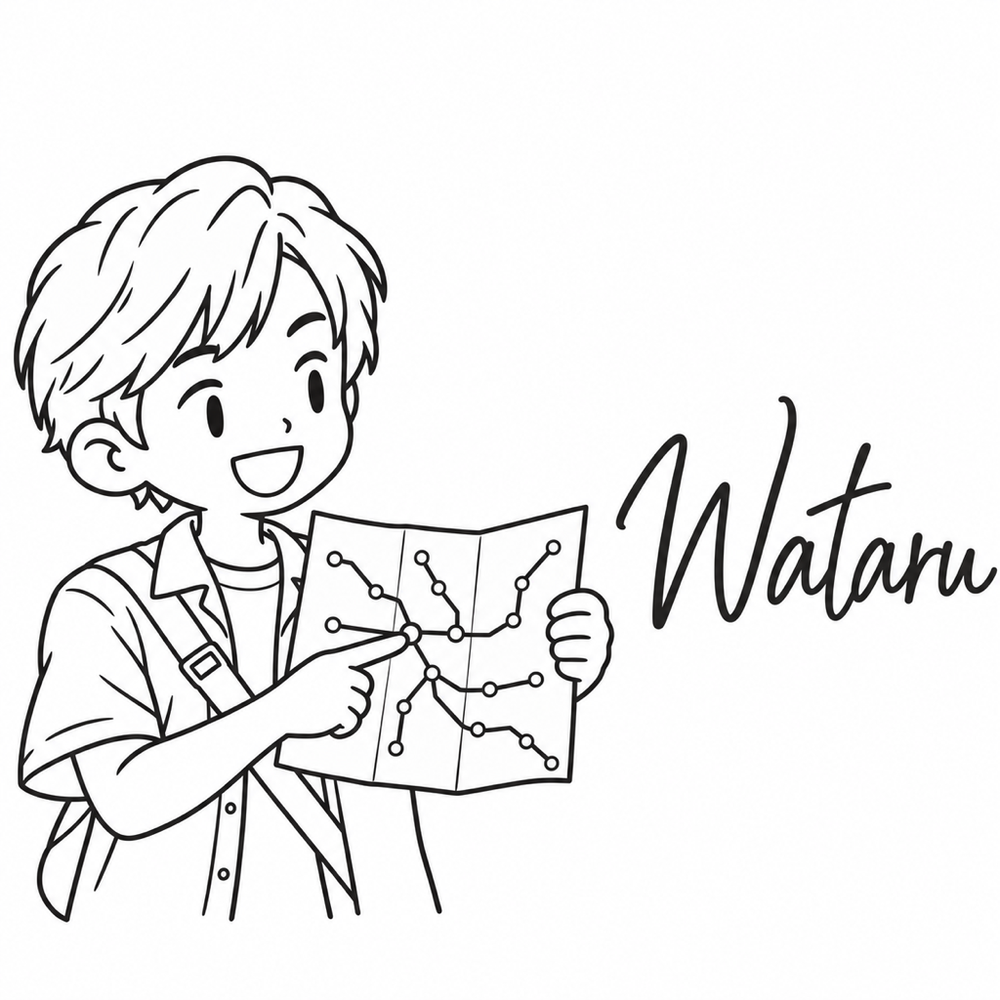

# わたる

| 項目 | 内容 |
| --- | --- |
| ポジション | フロントエンドエンジニア |
| 興味のあること | 駅や空港の案内表示 |
| 得意なこと | 初めての駅でも、迷わず出口を見つける |
| 苦手なこと | 行き先の書かれていない案内板 |
| 好きな食べ物 | 空港のカレー |
| 口癖 | 「次はどっちへ行けばいい？」 |
| 学生の時に学んだこと | サインデザイン。案内表示の分かりやすさ |
| 最近気になっていること | 案内表示のピクトグラム |
| 休日の過ごし方 | 知らない駅で降り、出口ごとに歩いてみる |
| 見た目の特徴 | 耳にかかるさらっとした髪、Tシャツに半袖の開襟シャツ、肩から斜めにかけたバッグのストラップ、路線図 |
| 仲のよいキャラクター | しるべ（古い地図と案内表示で、道の話が合う） |
