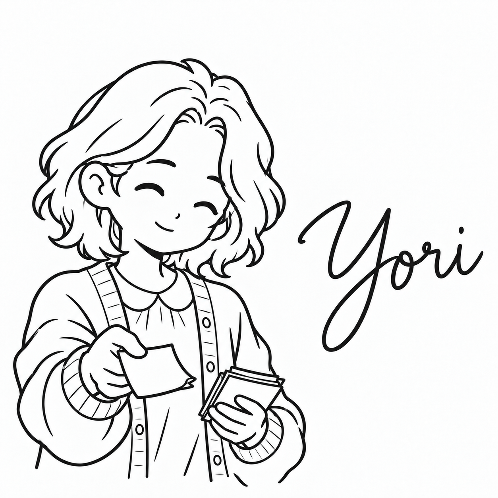

# より

| 項目 | 内容 |
| --- | --- |
| ポジション | UXデザイナー |
| 興味のあること | 絵本 |
| 得意なこと | 子どもにも分かる言葉で説明する |
| 苦手なこと | 小さすぎる文字 |
| 好きな食べ物 | ホットケーキ |
| 口癖 | 「初めての人にも分かるかな？」 |
| 学生の時に学んだこと | 児童文学。子どもに伝わる言葉 |
| 最近気になっていること | 子ども向けの図鑑 |
| 休日の過ごし方 | 絵本の読み聞かせのボランティア |
| 見た目の特徴 | 肩までのゆるいウェーブの髪、丸襟のブラウスにカーディガン、付箋の束 |
| 仲のよいキャラクター | ゆい（文字の大きさと余白の話が合う） |
