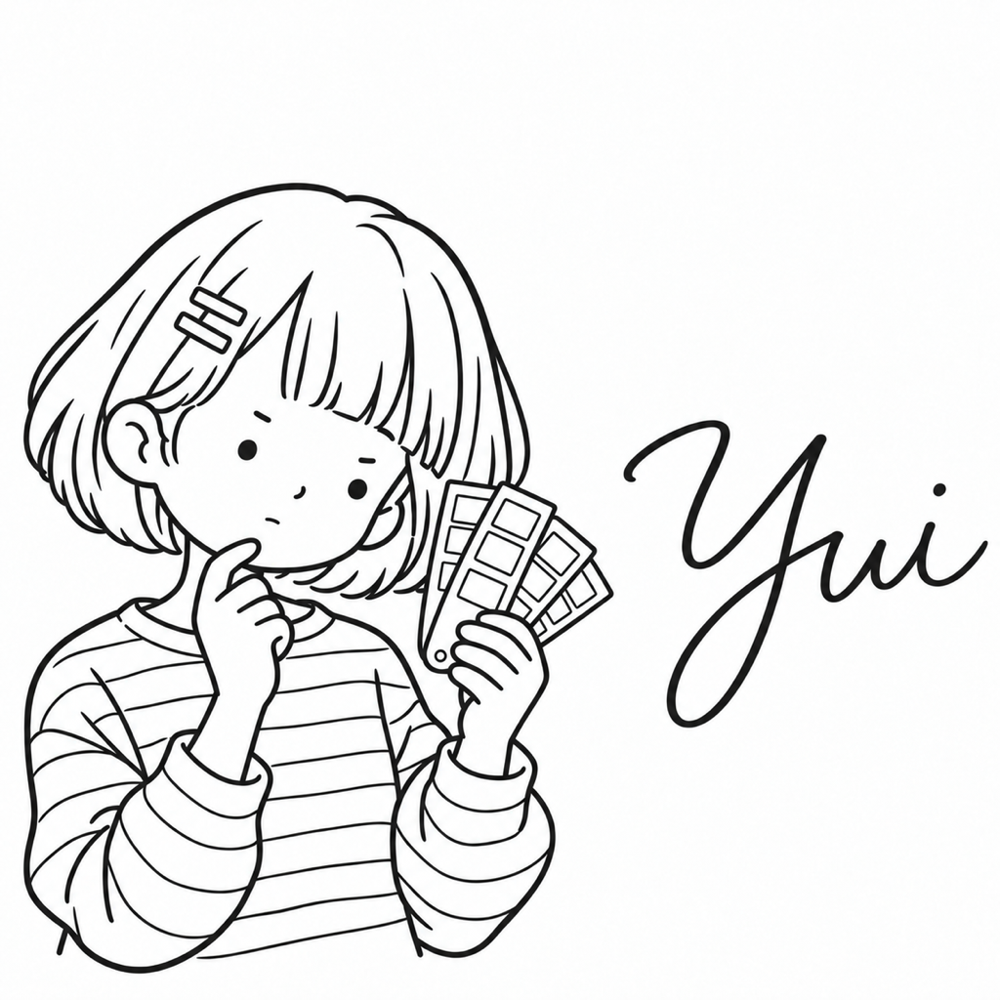

# ゆい

| 項目 | 内容 |
| --- | --- |
| ポジション | UIエンジニア |
| 興味のあること | 古い雑誌のレイアウト |
| 得意なこと | 部屋の飾りを、季節ごとに替える |
| 苦手なこと | 文字の大きさのそろっていない紙 |
| 好きな食べ物 | ラテアートのきれいなカフェラテ |
| 口癖 | 「余白、そろってる？」 |
| 学生の時に学んだこと | グラフィックデザイン。文字の組み方と余白 |
| 最近気になっていること | 活版印刷 |
| 休日の過ごし方 | 古本屋で古い雑誌を探す |
| 見た目の特徴 | 前髪をそろえた丸いボブ、本人の右の前髪にヘアピン2本、細いボーダーのカットソー、色見本の束 |
| 仲のよいキャラクター | より（文字の大きさと余白の話が合う） |
